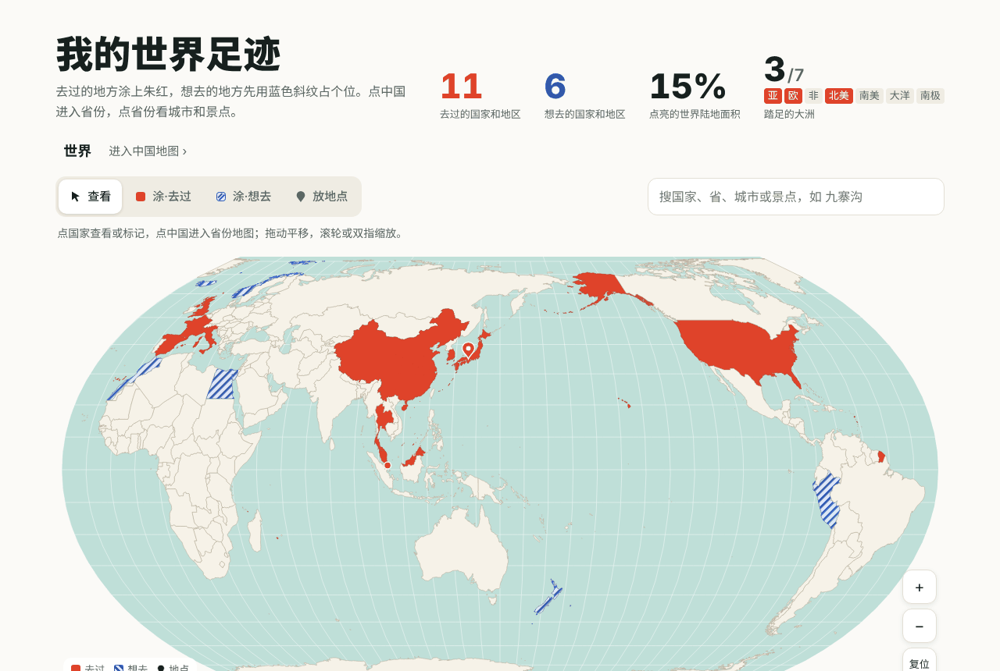
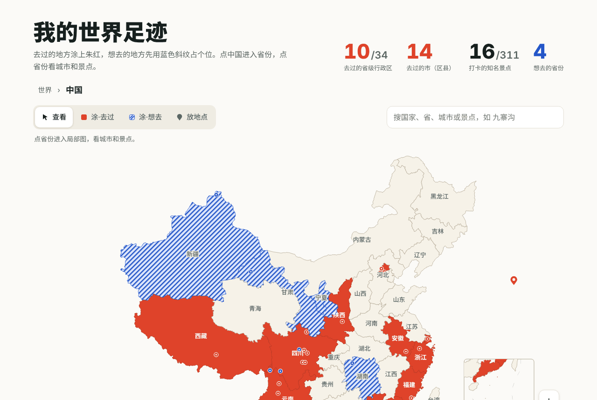
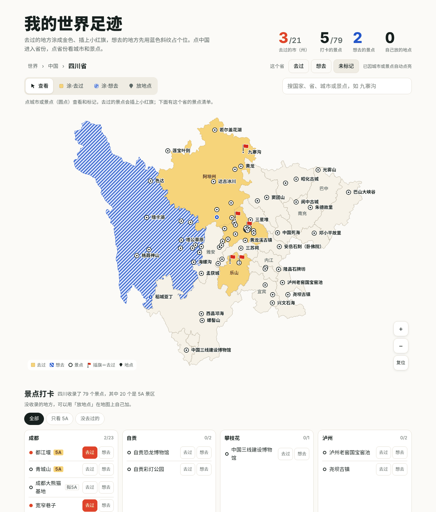

# 我的世界足迹 · Travel Footprints

一张可以自己标记的旅行足迹地图。去过的地方涂成**金色**、插上**小红旗**，想去的地方用**蓝色斜纹**占个位，从世界一路点进中国的省、市和景点。

纯静态网页，用 GitHub Pages 免费托管，不需要服务器也能用。有自己的服务器的话，还可以放一份国内镜像，并让朋友登录后一起编辑。

**在线地图**：点仓库页面右侧 About 里的链接。



## 能做什么

- **三级地图，点一下进下一层**：世界 → 中国（34 个省级行政区，附南海诸岛）→ 省（全部地级市，直辖市为区县）。
- **标记「去过 / 想去」**：国家、省、市、景点都能标，每个标记都可以写时间和备注。
- **景点打卡清单**：收录 1681 个景点，覆盖全部**国家 5A 级旅游景区**（截至 2026 年 11 月，含公示中的 17 家，标为「拟5A」）、小红书、马蜂窝、携程等平台攻略里推荐的热门去处（比如哈尔滨中华巴洛克、长春这有山、三亚千古情、海口华谊电影公社）、全国主要主题乐园（方特、欢乐谷、融创、乐高乐园等）和全部 13 个千古情景区，以及各省省级博物馆和主要城市的博物馆。在省地图下方按城市分组，一键勾选，可以只看 5A 或只看没去过的。
- **自动点亮**：去过一个景点或城市，所在的省和中国会自动点亮。
- **插小红旗**：省地图上去过的景点、中国地图上去过的城市，都会插上一面小红旗。
- **放地点**：收录之外的地方，可以在地图任意位置放一个图钉。
- **统计**：去过几个国家、点亮了多少世界陆地、踏足几个大洲；在中国去过几个省、几个市、打卡几个景点。
- **搜索**：国家、省、城市、景点都能搜，搜「九寨沟」会直接跳到四川地图。
- **多设备同步**：连上 GitHub 后，标记自动保存到仓库里，电脑、手机都能改；别人打开网址只能看，不能改。
- **登录后一起编辑**（v3.0，需要自己的服务器）：给朋友一个账号密码，他们点地图上方的「登录编辑」，就能和你一样修改同一张地图；每次修改都会在 GitHub 上留下记录，写明是谁改的。
- **两个网址**：页面顶部列出 GitHub Pages 和国内镜像两个网址，国外、国内各选快的那个打开。
- 手机、电脑都能用，支持深色模式。

| 中国：点省份进入局部图 | 省：城市 + 景点打卡 | 手机上 |
|---|---|---|
|  |  |  |

<sub>截图中的标记是示例数据。</sub>

---

## 做一张你自己的

1. 点本仓库右上角的 **Fork**，复制一份到你自己的账号。
2. 在你的仓库里打开 **Settings → Pages**，Source 选 **Deploy from a branch**，Branch 选 **main**、文件夹选 **/(root)**，点 Save。等 1～2 分钟，网址是 `https://你的用户名.github.io/仓库名/`。
3. 把 `footprints.json` 的内容改成 `{"v":2,"marks":{},"pins":{}}`，清掉原作者的足迹（在 GitHub 网页上点这个文件 → 铅笔图标 → 修改 → Commit）。
   再把 `site.json` 里的网址改成你自己的；没有自己的服务器就把 `api` 改成 `""`、`sites` 改成 `[]`（见下面「让别人登录后一起编辑」）。
4. 按下面的「让标记保存到仓库」连接你自己的令牌，就可以开始标了。

## 部署步骤（从压缩包上传）

1. **新建仓库**：GitHub 右上角「+」→ New repository，选 **Public**，然后 Create repository。
2. **上传文件**：在新仓库页面点 **uploading an existing file**，把文件夹里的**全部内容**（`index.html`、`app.js`、`style.css`、`site.json`、`footprints.json`、`README.md`，以及 `data`、`lib`、`fonts`、`mirror`、`docs` 这几个文件夹）一起拖进去，再点 Commit changes。
3. **打开 Pages**：Settings → Pages → Source 选 **Deploy from a branch**，Branch 选 **main**、文件夹选 **/(root)**，点 Save。

## 让标记保存到仓库

GitHub Pages 只能放静态文件，网页需要一个「钥匙」，才能把你的标记写回仓库：

1. GitHub 右上角头像 → **Settings** → 左下 **Developer settings** → **Personal access tokens** → **Fine-grained tokens** → **Generate new token**。
2. Token name 随便填；Expiration 选一个有效期（到期后重新生成一个即可）。
3. **Repository access** 选 **Only select repositories**，只勾选这个地图仓库。
4. **Permissions → Repository permissions → Contents** 选 **Read and write**，其他都不用动。
5. 生成后，复制以 `github_pat_` 开头的令牌。
6. 打开你的地图网址，拉到最底部点 **连接 GitHub**，粘贴令牌，再点「连接」。

连接之后：

- 每次标记后，停手约 1.5 秒就会自动保存到仓库里的 `footprints.json`（每次保存是一次提交，说明为「更新旅行足迹」）。
- 换一台设备时，在那台设备上也点一次「连接 GitHub」。
- 令牌只存在你自己设备的浏览器里。公用电脑上不要连接；令牌泄露的话，到 GitHub 上删掉它即可。

不连 GitHub 也能用：标记会存在当前浏览器里，但换浏览器或清缓存后会丢。页面底部的「备份与恢复」可以随时把全部标记复制成一段文字保存。

## 国内镜像（放到自己的服务器上）

GitHub Pages 在国内打开比较慢。有自己的服务器和域名的话，可以再放一份镜像，服务器每分钟从 GitHub 同步一次：

1. 把域名解析到服务器的 IP，并在服务器商控制台的安全组里放行 TCP 80 和 443 端口。
2. 用 root 登录服务器，运行（最后换成你的域名；仓库不是 Yexika/travel-footprints 的话，在域名后面再写上 `用户名/仓库名`）：

   ```bash
   curl -fsSLo setup.sh https://raw.githubusercontent.com/Yexika/travel-footprints/main/mirror/setup.sh
   bash setup.sh 你的域名
   ```

脚本会装好 nginx，把网页下载到 `/var/www/travel-footprints`，设置每分钟同步（只用 curl，不需要 git），开启 gzip 压缩，并申请免费的 HTTPS 证书。服务器上不需要 GitHub 令牌。

**服务器的 443 端口已经被 Xray Reality 使用时**，改用 `setup-reality.sh`（用法相同，把上面命令里的 `setup.sh` 换成 `setup-reality.sh`）。它让 HAProxy 接管 443 端口（Debian 11 自带的 nginx 不支持按域名分流），只看连接里的域名来分流：访问网站域名的交给网站，其余连接原样转给 Xray（改为只在本机监听），代理客户端不用改。改 Xray 之前会备份，切换后自动检查网站和 Reality，不通过就自动恢复原样；`bash setup-reality.sh --undo` 可以随时撤销。

- 无论在 GitHub Pages 还是在镜像站上标记，足迹都保存到 GitHub，镜像站一分钟内就会同步到。
- 镜像站的访客直接读服务器上的 `footprints.json`，不经过 GitHub，所以国内打开更快。
- 在镜像站上编辑需要再点一次「连接 GitHub」，因为令牌是按网址分别保存在浏览器里的。
- 以后网页更新，只要上传到 GitHub，镜像站会自动跟着更新。

## 让别人登录后一起编辑（v3.0）

需要先按上一节部署好国内镜像。登录和保存都由你的服务器负责：

- 账号由你在服务器上添加。密码只以加盐哈希的形式保存；同一个账号连续输错 5 次，会暂停 15 分钟。
- 登录后的改动发给服务器，由服务器用它自己保存的 GitHub 令牌提交到仓库，令牌不会发给浏览器。服务器会在 GitHub 上最新的 `footprints.json` 上合并改动，几个人同时改不同的地方不会互相覆盖。
- GitHub Pages 和镜像站两个网址都用这个服务登录，改的是同一张地图。你自己原来用令牌「连接 GitHub」的方式照常可用。

部署：把 `mirror/setup-api.sh` 传到服务器，用 root 运行 `bash setup-api.sh`。它会提示粘贴一个 GitHub 令牌（建议给服务器单独建一个，权限和上面「让标记保存到仓库」一样），再设置你自己的账号。之后在服务器上管理账号：

```bash
travel-footprints-user add 名字      # 添加账号（会提示设置密码）
travel-footprints-user passwd 名字   # 改密码（这个账号已登录的设备需要重新登录）
travel-footprints-user del 名字      # 删除账号
travel-footprints-user list          # 列出账号
travel-footprints-user logout 名字   # 让这个账号在所有设备上退出登录
travel-footprints-user token         # 更换服务器上的 GitHub 令牌
travel-footprints-user check         # 检查配置和令牌
```

网页通过仓库里的 `site.json` 找到登录服务和两个网址。做自己的地图时，把里面的地址改成你自己的；不需要登录功能就把 `api` 改成空字符串 `""`：

```json
{
  "api": "https://你的域名/api",
  "sites": [
    { "name": "GitHub Pages", "desc": "国外访问更快", "url": "https://你的用户名.github.io/仓库名/" },
    { "name": "国内镜像", "desc": "国内访问更快", "url": "https://你的域名/" }
  ]
}
```

改错了也能找回：每次修改都是仓库里的一次提交（说明为「更新旅行足迹（账号名）」），可以在 GitHub 上查看历史，把 `footprints.json` 恢复到之前的版本。

## 文件说明

| 文件 | 作用 |
|---|---|
| `index.html` / `style.css` / `app.js` | 网页本体 |
| `footprints.json` | 足迹数据（连接 GitHub 后由网页自动更新） |
| `data/world.json` | 世界国界 |
| `data/china.json` | 中国省界与南海诸岛 |
| `data/prov/<省代码>.json` | 各省的市（区县）边界，进入该省时才加载 |
| `data/names.json` | 省、市名称 |
| `data/centers.json` | 各省、市政府所在地坐标（插旗位置） |
| `data/spots.json` | 景点清单 |
| `lib/` | 地图组件 D3 和 topojson-client（放在仓库里，不依赖国外 CDN） |
| `fonts/` | 数字用的 Archivo 字体（中文用系统自带字体） |
| `mirror/setup.sh` | 在自己服务器上部署国内镜像的脚本 |
| `mirror/setup-reality.sh` | 同上，用于 443 端口已经被 Xray Reality 使用的服务器 |
| `mirror/setup-api.sh` | 在服务器上部署登录编辑服务和账号管理命令 |
| `site.json` | 登录服务地址和页面顶部列出的网址 |
| `docs/` | README 里的截图 |
| `CHANGELOG.md` | 更新日志（每个版本改了什么） |

### 往清单里加景点

在 `data/spots.json` 里加一条即可：

```json
{"id":"s-51-xiaozhong","n":"我家附近的小众景点","p":"510000","c":"510100","lon":104.07,"lat":30.57}
```

- `id`：格式是 `s-` + 省代码前两位 + `-` + 小写字母或数字（最多 20 个）。不能和已有的重复，加上以后也不要再改。
- `n`：景点名；`p`：省代码；`c`：所在市的代码（在 `data/names.json` 里查）。
- `lon` / `lat`：经度、纬度。
- `g`（可选）：`"5A"` 表示国家 5A 级旅游景区，`"拟5A"` 表示公示中；普通景点不用写。

### 改标题

标题和副标题在 `index.html` 的 `<h1>` 和下面一行 `<p>` 里，直接改文字就行。

### 本地预览

地图数据是用 `fetch` 读取的，**直接双击 `index.html` 打不开地图**。要在本地看，在这个文件夹里运行：

```bash
python3 -m http.server 8000
```

然后在浏览器打开 `http://localhost:8000`。

## 数据来源

- 世界国界：Natural Earth（公有领域），经 [world-atlas](https://github.com/topojson/world-atlas) 整理；世界图层中的中国轮廓换成了与省界同源的数据。
- 中国省、市边界：阿里云 DataV.GeoAtlas（经 [GeoMapData_CN](https://github.com/lyhmyd1211/GeoMapData_CN) 整理，2022 年版），已简化。
- 5A 名单依据文化和旅游部历次公告整理（截至 2026 年 11 月：358 家已确定，17 家公示中）。一个 5A 景区包含多处景点时（如苏州园林），清单里会分开列出。
- 景点坐标是人工整理的大致位置，用来在地图上打点，不适合导航。
- 绘图：[D3](https://d3js.org)、[topojson-client](https://github.com/topojson/topojson-client)（ISC 许可，见 `lib/`）。
- 数字字体：[Archivo](https://github.com/Omnibus-Type/Archivo)（SIL Open Font License，见 `fonts/OFL.txt`）。
