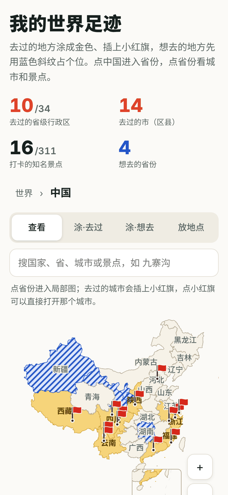

# 我的世界足迹 · Travel Footprints

一张可以自己标记的旅行足迹地图。去过的地方涂成**金色**、插上**小红旗**，想去的地方用**蓝色斜纹**占个位，从世界一路点进中国的省、市和景点。

纯静态网页，用 GitHub Pages 免费托管，不需要服务器，也不用安装任何东西。

**在线地图**：点仓库页面右侧 About 里的链接。


## 能做什么

- **三级地图，点一下进下一层**：世界 → 中国（34 个省级行政区，附南海诸岛）→ 省（全部地级市，直辖市为区县）。
- **标记「去过 / 想去」**：国家、省、市、景点都能标，每个标记都可以写时间和备注。
- **景点打卡清单**：收录了 311 个知名景点，比如九寨沟、峨眉山、黄山、西湖、布达拉宫。在省地图下方按城市分组，一键勾选。
- **自动点亮**：去过一个景点或城市，所在的省和中国会自动点亮。
- **插小红旗**：省地图上去过的景点、中国地图上去过的城市，都会插上一面小红旗。
- **放地点**：收录之外的地方，可以在地图任意位置自己插旗。
- **统计**：去过几个国家、点亮了多少世界陆地、踏足几个大洲；在中国去过几个省、几个市、打卡几个景点。
- **搜索**：国家、省、城市、景点都能搜，搜「九寨沟」会直接跳到四川地图。
- **多设备同步**：连上 GitHub 后，标记自动保存到仓库里，电脑、手机都能改；别人打开网址只能看，不能改。
- 手机、电脑都能用，支持深色模式。

| 中国：点省份进入局部图 | 省：城市 + 景点打卡 | 手机上 |
|---|---|---|
|  |  |  |

<sub>截图中的标记是示例数据。</sub>

---

## 做一张你自己的

1. 点本仓库右上角的 **Fork**，复制一份到你自己的账号。
2. 在你的仓库里打开 **Settings → Pages**，Source 选 **Deploy from a branch**，Branch 选 **main**、文件夹选 **/(root)**，点 Save。等 1～2 分钟，网址是 `https://你的用户名.github.io/仓库名/`。
3. 把 `footprints.json` 的内容改成 `{"v":2,"marks":{},"pins":{}}`，清掉原作者的足迹（在 GitHub 网页上点这个文件 → 铅笔图标 → 修改 → Commit）。
4. 按下面的「让标记保存到仓库」连接你自己的令牌，就可以开始标了。

## 部署步骤（从压缩包上传）

1. **新建仓库**：GitHub 右上角「+」→ New repository，选 **Public**，然后 Create repository。
2. **上传文件**：在新仓库页面点 **uploading an existing file**，把文件夹里的**全部内容**（`index.html`、`app.js`、`style.css`、`footprints.json`、`README.md`，以及 `data`、`docs` 两个文件夹）一起拖进去，再点 Commit changes。
3. **打开 Pages**：Settings → Pages → Source 选 **Deploy from a branch**，Branch 选 **main**、文件夹选 **/(root)**，点 Save。

## 让标记保存到仓库

GitHub Pages 只能放静态文件，网页需要一个「钥匙」，才能把你的标记写回仓库：

1. GitHub 右上角头像 → **Settings** → 左下 **Developer settings** → **Personal access tokens** → **Fine-grained tokens** → **Generate new token**。
2. Token name 随便填；Expiration 选一个有效期（到期后重新生成一个即可）。
3. **Repository access** 选 **Only select repositories**，只勾选这个地图仓库。
4. **Permissions → Repository permissions → Contents** 选 **Read and write**，其他都不用动。
5. 生成后，复制以 `github_pat_` 开头的令牌。
6. 打开你的地图网址，拉到最底部点 **连接 GitHub**，粘贴令牌，再点「连接」。

连接之后：

- 每次标记后，停手约 1.5 秒就会自动保存到仓库里的 `footprints.json`（每次保存是一次提交，说明为「更新旅行足迹」）。
- 换一台设备时，在那台设备上也点一次「连接 GitHub」。
- 令牌只存在你自己设备的浏览器里。公用电脑上不要连接；令牌泄露的话，到 GitHub 上删掉它即可。

不连 GitHub 也能用：标记会存在当前浏览器里，但换浏览器或清缓存后会丢。页面底部的「备份与恢复」可以随时把全部标记复制成一段文字保存。

## 文件说明

| 文件 | 作用 |
|---|---|
| `index.html` / `style.css` / `app.js` | 网页本体 |
| `footprints.json` | 足迹数据（连接 GitHub 后由网页自动更新） |
| `data/world.json` | 世界国界 |
| `data/china.json` | 中国省界与南海诸岛 |
| `data/prov/<省代码>.json` | 各省的市（区县）边界，进入该省时才加载 |
| `data/names.json` | 省、市名称 |
| `data/centers.json` | 各省、市政府所在地坐标（插旗位置） |
| `data/spots.json` | 景点清单 |
| `docs/` | README 里的截图 |

### 往清单里加景点

在 `data/spots.json` 里加一条即可：

```json
{"id":"s-51-bipenggou","n":"毕棚沟","p":"510000","c":"513200","lon":102.90,"lat":31.33}
```

- `id`：格式是 `s-` + 省代码前两位 + `-` + 小写字母或数字（最多 20 个）。不能和已有的重复，加上以后也不要再改。
- `n`：景点名；`p`：省代码；`c`：所在市的代码（在 `data/names.json` 里查）。
- `lon` / `lat`：经度、纬度。

### 改标题

标题和副标题在 `index.html` 的 `<h1>` 和下面一行 `<p>` 里，直接改文字就行。

### 本地预览

地图数据是用 `fetch` 读取的，**直接双击 `index.html` 打不开地图**。要在本地看，在这个文件夹里运行：

```bash
python3 -m http.server 8000
```

然后在浏览器打开 `http://localhost:8000`。

## 数据来源

- 世界国界：Natural Earth（公有领域），经 [world-atlas](https://github.com/topojson/world-atlas) 整理；世界图层中的中国轮廓换成了与省界同源的数据。
- 中国省、市边界：阿里云 DataV.GeoAtlas（经 [GeoMapData_CN](https://github.com/lyhmyd1211/GeoMapData_CN) 整理，2022 年版），已简化。
- 景点坐标是人工整理的大致位置，用来在地图上打点，不适合导航。
- 绘图：[D3](https://d3js.org)、[topojson-client](https://github.com/topojson/topojson-client)。
